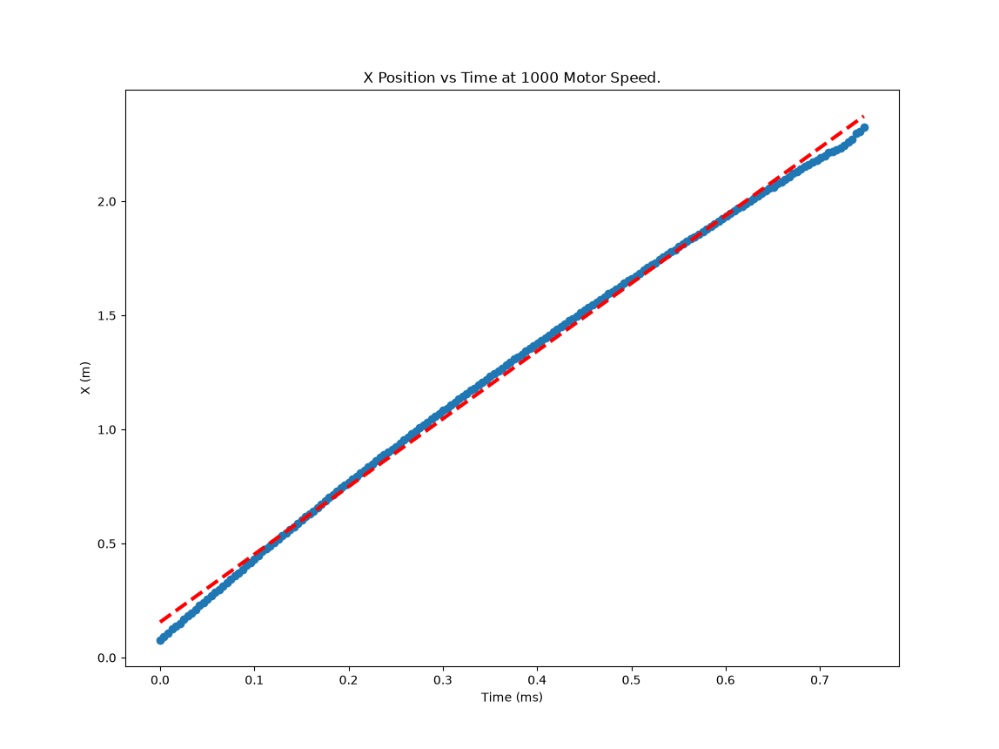
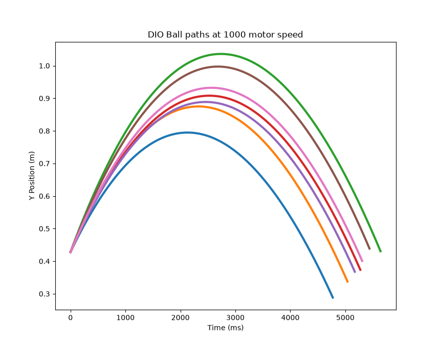

# Ball Positioning

__This Repository is created by FTC team 6093 for the 2026-2027 BioBuzz competition.__

This python package serves to take real world experimental data of a robot's trajectory and analyze it. 

From an analysis can decisions be made about level of precision required to accurately make shots and projected shot success.

## What level of fidelity is needed, and how much air resistance is there?

When analyzing the X position over time graph, there is a discrepancy between a linear line fit (dashed line in red), and the actual data points (blue).

The discrepancy is because of air resistance, as the velocity decreases over time, the Magnus effect, but also experimental error such as camera radial distortion.

Camera radial distortion is, however, acting against the effect shown in the graph.

The big question is: do we need to model the x velocity of the ball using a 2nd degree polynomial.

## Shooting error

For a particular motor speed, there is error between shots: no shot is the exact same. To quantify and model this error, we have done many trials at a set motor speed.

Here is seven trials at 1000 motor speed that show the wild differences and effective shooting angle and velocity.